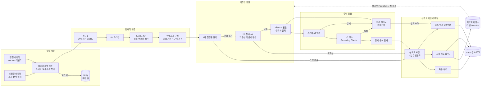
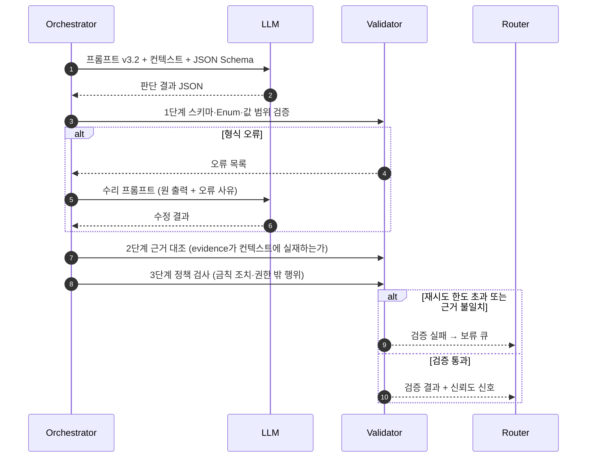
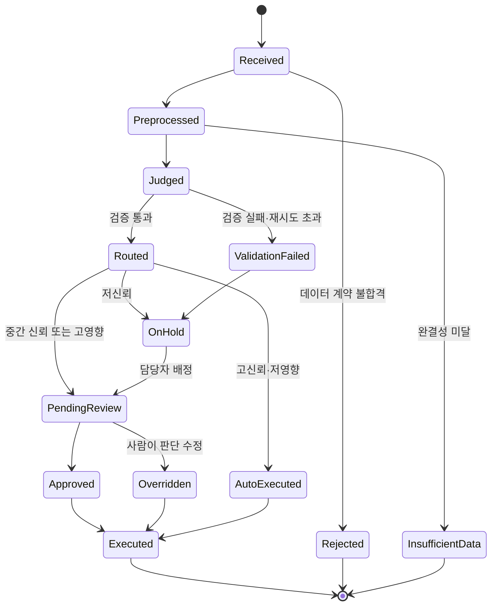
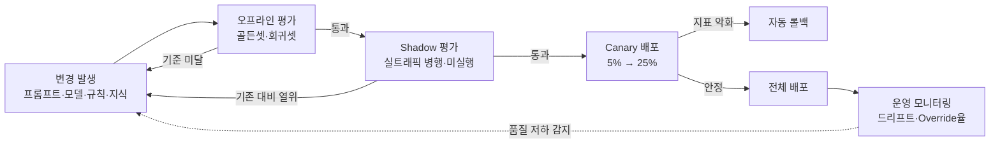
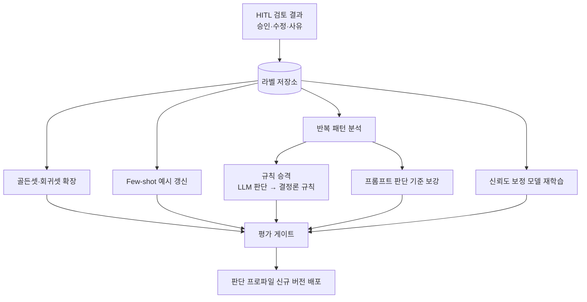

# AI 처리 파이프라인 및 판단 품질 보장 설계

## 1. 핵심 요약

LLM은 동일 입력에도 출력이 달라질 수 있는 확률적 모델이며, 환각(Hallucination)·근거 없는 단정·형식 오류·모델 업데이트에 따른 성능 변화가 구조적으로 존재합니다. 따라서 판단 품질은 "좋은 프롬프트"가 아니라 **파이프라인 전 구간의 통제 장치**로 보장해야 합니다.

본 설계의 핵심은 다음 다섯 가지입니다.

| 구분 | 설계 방향 |
|---|---|
| 판단 구조 | 결정론 규칙 → 통계·ML → LLM 순의 **계층형(Cascade) 판단**. LLM은 앞 단계가 판단하지 못한 영역만 담당 |
| 출력 통제 | 구조화 출력(JSON Schema) + 다단계 Guardrail(스키마·값 범위·근거·정책) + 수리(Repair) 재시도 |
| 신뢰도 기반 실행 | 다중 신호로 보정한 신뢰도와 업무 영향도를 결합해 **자동 처리 / 사람 검토(HITL) / 보류**로 라우팅 |
| 품질 측정 | 골든셋 기반 오프라인 평가, Shadow·Canary 온라인 평가, 운영 지표(Override율·드리프트) 상시 측정 |
| 변경 통제 | 프롬프트·모델·규칙·지식을 버전 자산으로 관리하고, **평가 게이트 통과 시에만 배포**. 모든 판단은 재현 가능한 추적 정보 기록 |

---

## 2. 문제 정의

### 2.1 AI 판단 품질 저하 요인

| 요인 | 현상 | 영향 |
|---|---|---|
| 입력 품질 | 누락·중복·지연 데이터, 비정형 노이즈, 개인정보 혼입 | 잘못된 전제 위에서 판단 |
| 컨텍스트 부족 | 필요한 근거 문서·이력이 검색되지 않음 | 추측성 답변, 환각 |
| 모델 비결정성 | 동일 입력 다른 출력, 형식 이탈 | 재현 불가, 후속 시스템 파싱 실패 |
| 과신(Overconfidence) | 모델이 스스로 보고한 신뢰도가 실제 정확도와 불일치 | 오판이 자동 실행됨 |
| 드리프트 | 입력 분포·업무 규칙·모델 버전 변화 | 시간이 지나며 조용히 품질 하락 |
| 외부 의존 장애 | LLM API 지연·Rate Limit·장애 | 파이프라인 정지 또는 불완전 결과 |

### 2.2 품질 목표의 정의

판단 품질은 단일 정확도가 아니라 다음 다섯 가지 속성의 조합으로 정의합니다.

1. **정확성(Accuracy)**: 정답 대비 판단 일치율, Precision/Recall
2. **근거성(Groundedness)**: 판단이 제공된 근거 데이터에서 도출되었는지 여부
3. **일관성(Consistency)**: 동일·유사 입력에 대한 판단의 안정성
4. **재현성(Reproducibility)**: 특정 판단을 사후에 동일 조건으로 재현·설명 가능 여부
5. **안전성(Safety)**: 오판 시 업무 피해가 통제 범위 안에 있는지 여부

---

## 3. 설계 원칙

| 원칙 | 내용 |
|---|---|
| 결정론 우선 | 규칙으로 판정 가능한 영역은 LLM에 맡기지 않습니다. LLM은 비정형 해석과 모호한 판단에만 사용합니다 |
| 근거 강제 | 모든 판단은 근거(입력 필드, 문서 ID, 수치)를 함께 출력해야 하며, 근거가 없는 판단은 무효 처리합니다 |
| 실패 안전(Fail-safe) | 검증 실패·저신뢰·장애 시 기본값은 "자동 실행"이 아니라 "보류 또는 사람 검토"입니다 |
| 관측 가능성 | 입력·컨텍스트·프롬프트 버전·모델·출력·검증 결과·최종 결정을 단일 Trace로 연결합니다 |
| 평가 주도 변경 | 프롬프트·모델 변경도 코드 변경과 동일하게 회귀 평가를 통과해야 배포합니다 |
| 피드백 폐루프 | 사람의 수정 결과를 라벨로 축적해 평가셋·Few-shot·규칙으로 환류합니다 |

---

## 4. 전체 아키텍처

---

## 5. 단계별 상세 설계

### 5.1 입력 계층: 데이터 계약과 멱등성

- **데이터 계약(Data Contract)**: 소스별 스키마·필수 필드·허용 값 범위·갱신 주기를 계약으로 정의하고, 수집 시점에 검증합니다. 불합격 데이터는 버리지 않고 DLQ(Dead Letter Queue)로 격리해 원인 분석과 재처리가 가능하도록 합니다.
- **멱등성(Idempotency)**: `소스 + 비즈니스 키 + 시간 버킷`으로 멱등 키를 생성해 재수집·재시도 시 중복 판단을 방지합니다.
- **지연 데이터 처리**: 이벤트 시간 기준 Watermark를 두고, 허용 지연 이후 도착한 데이터는 보정 배치로 재판단합니다.
- **완결성 점검**: 판단 대상 구간의 데이터 수집률이 기준(예: 95%) 미만이면 판단을 생략하고 "데이터 부족" 상태로 기록합니다. 불완전한 데이터로 내린 판단이 정상 판단처럼 보이는 것을 막기 위함입니다.

### 5.2 전처리 계층: LLM에 들어가기 전 품질 확보

| 처리 | 목적 | 구현 예 |
|---|---|---|
| 정규화 | 동일 의미 데이터의 표현 통일 | 시간대 UTC 통일, 통화·단위 변환, 코드 매핑 |
| PII 마스킹 | 개인정보 외부 모델 전송 차단 | 정규식 + NER 기반 탐지, 가역 토큰화(필요 시 복원) |
| 노이즈 제거 | 판단 무관 정보로 인한 오판 방지 | 반복 로그 시그니처 집약, 무의미 패턴 필터 |
| 시그니처화 | 유사 입력을 동일 그룹으로 묶어 일관 판단 | 가변값(ID·숫자·UUID) 치환 후 해시 |
| 컨텍스트 구성 | 판단 근거 제공 | 과거 동일 시그니처 이력, 기준선 통계, 관련 규정 검색(RAG) |
| 토큰 예산 관리 | 비용·지연 상한 및 핵심 정보 유실 방지 | 우선순위 기반 절단, 요약 압축, 샘플링 |

### 5.3 계층형 판단(Cascade) 설계

모든 입력을 LLM으로 처리하면 비용·지연·비결정성이 모두 커집니다. 판단을 세 단계로 나누고, 각 단계에서 확정 가능한 건은 즉시 종료합니다.

| 단계 | 담당 영역 | 특성 | 처리 비중(예시) |
|---|---|---|---|
| 1차 결정론 규칙 | 명시 정책, 임계값, 화이트·블랙리스트 | 100% 재현, ms 단위, 비용 0 | 50~70% |
| 2차 통계·ML | 기준선 대비 이탈(Z-score, EWMA, 계절성 분해), 분류 모델 | 확률 점수 산출, 저비용 | 20~30% |
| 3차 LLM | 비정형 해석, 복합 원인 추론, 설명 생성 | 고비용·고지연·비결정 | 10~20% |

판단 이관 기준은 "상위 단계의 신뢰도가 임계값 미만이거나, 상위 단계가 해석할 수 없는 비정형 입력"으로 명시합니다. 또한 **LLM 판단이 반복적으로 동일한 결론을 내는 패턴은 규칙으로 승격**해 점진적으로 LLM 의존도를 낮춥니다.

### 5.4 LLM 판단 품질 확보 기법

| 기법 | 설명 | 효과 |
|---|---|---|
| 구조화 출력 | JSON Schema·Function Calling으로 출력 형식 강제. 판단값은 Enum으로 제한 | 파싱 실패 제거, 자유 서술 오판 방지 |
| 결정성 설정 | Temperature 0, Seed 고정, 모델 버전 Pinning | 출력 변동 최소화 |
| 근거 필드 강제 | `decision`, `evidence[]`(입력 필드·문서 ID 인용), `reasoning_summary`, `confidence` 분리 출력 | 근거 대조 검증 가능 |
| 판단 기준 명시 | 프롬프트에 판정 기준표·반례·"판단 불가" 선택지 제공 | 억지 판단 대신 보류 유도 |
| Few-shot | 대표 사례와 경계 사례를 동적 선택(유사도 기반) | 경계 케이스 정확도 향상 |
| Self-consistency | 고위험 건은 N회 샘플링 후 다수결, 일치율을 신뢰도 신호로 사용 | 우연한 오판 억제 |
| 교차 검증(LLM-as-Judge) | 별도 모델·프롬프트가 판단과 근거의 정합성 평가 | 환각·논리 비약 탐지 |
| 컨텍스트 격리 | 입력 데이터를 지시문과 분리된 구획에 배치, 데이터 내 지시문 무시 명시 | 프롬프트 인젝션 방어 |

### 5.5 출력 검증(Guardrail)과 수리 재시도

- **1단계 형식 검증**: 스키마 적합성, Enum 범위, 수치 범위, 필수 필드 존재
- **2단계 근거 대조(Grounding Check)**: `evidence`로 인용한 필드값·문서 ID·수치가 실제 컨텍스트에 존재하는지 문자열·수치 비교로 확인합니다. 인용 없는 단정, 컨텍스트에 없는 수치는 환각으로 간주합니다.
- **3단계 정책 검증**: 판단 결과가 업무 정책(예: 금액 한도, 금지 조치, 권한 범위)을 위반하는지 결정론 엔진으로 검사합니다.
- **수리 재시도**: 실패 사유를 피드백으로 포함해 재요청하며, 최대 횟수(예: 2회)를 초과하면 보류 처리합니다. 무한 재시도는 비용과 지연만 키우므로 금지합니다.

### 5.6 신뢰도 보정과 위험 기반 라우팅

LLM이 스스로 출력한 `confidence`는 실제 정확도와 상관이 낮으므로 단독 사용하지 않습니다. 다음 신호를 결합해 **보정 신뢰도(Calibrated Confidence)**를 산출합니다.

| 신호 | 의미 |
|---|---|
| Self-consistency 일치율 | N회 샘플 중 동일 판단 비율 |
| 검색 근거 점수 | 상위 근거 문서의 Rerank 점수, 근거 수 |
| 규칙·통계 일치 여부 | 2차 통계 판단과 LLM 판단의 방향 일치 |
| 검증 이력 | 수리 재시도 발생 여부 |
| 과거 정확도 | 해당 판단 유형(시그니처)의 과거 HITL 승인율 |

결합 방식은 초기에는 가중합을 사용하고, 라벨이 축적되면 로지스틱 회귀·Isotonic Regression으로 실제 정답률에 맞게 보정합니다. 보정 품질은 ECE(Expected Calibration Error)로 측정합니다.

보정 신뢰도와 업무 영향도를 결합해 실행 경로를 결정합니다.

| 영향도 \ 신뢰도 | 높음(≥ 0.9) | 중간(0.6~0.9) | 낮음(< 0.6) |
|---|---|---|---|
| 낮음(조회·알림) | 자동 처리 | 자동 처리 + 사후 샘플 검수 | 사람 검토 |
| 중간(데이터 변경) | 자동 처리 + 사후 검수 | 사람 검토 | 보류 |
| 높음(금전·고객 영향) | 사람 승인 | 사람 승인 | 보류·에스컬레이션 |

임계값은 고정값이 아니라 운영 데이터로 조정하며, 목표 오판율(예: 자동 처리 건 오판 0.5% 이하)을 만족하는 최소 임계값으로 설정합니다.

### 5.7 판단 건의 상태 관리

모든 상태 전이는 이벤트로 기록하며, `Overridden` 건은 피드백 저장소로 전달되어 평가셋과 개선 작업의 입력이 됩니다.

---

## 6. 품질 평가 체계

### 6.1 평가 단계

| 단계 | 방법 | 통과 기준 예 |
|---|---|---|
| 오프라인 | 골든셋(정답 라벨 수백~수천 건) + 과거 오판 회귀셋 + 경계·적대 사례 | F1 기존 대비 하락 없음, 환각률 1% 이하, 형식 오류 0.1% 이하 |
| Shadow | 신규 버전을 실트래픽에 병행 실행하되 결과는 실행하지 않고 기존 결과와 비교 | 불일치 건 샘플 검수 시 신규 버전 우위 |
| Canary | 트래픽 일부에만 실제 적용 | Override율·오류율·지연 p95 기준 이내 |
| 운영 | 상시 지표 관측 | 임계 초과 시 알림·자동 롤백 |

### 6.2 핵심 지표

| 분류 | 지표 | 정의 |
|---|---|---|
| 정확성 | Precision / Recall / F1 | 골든셋 기준 판단 정확도 |
| 근거성 | Faithfulness, 환각률 | 근거 대조 실패 비율 |
| 일관성 | 반복 실행 일치율 | 동일 입력 N회 실행 시 동일 판단 비율 |
| 신뢰도 품질 | ECE | 보정 신뢰도와 실제 정답률의 차이 |
| 운영 효과 | 자동 처리율, HITL Override율 | 자동 처리 비중, 사람이 판단을 뒤집은 비율 |
| 안정성 | 검증 실패율, 재시도율, DLQ 적재량 | 파이프라인 건전성 |
| 효율 | 지연 p50/p95, 건당 토큰 비용 | 비기능 품질 |

**Override율**은 정답 라벨 없이 운영 중 측정 가능한 가장 강력한 품질 선행 지표이므로, 판단 유형별로 분리 관측하고 급증 시 즉시 원인 분석에 착수합니다.

---

## 7. 변경 관리와 재현성

### 7.1 판단 자산의 버전 관리

프롬프트, 모델 ID, 파라미터, 규칙 세트, Few-shot 예시, 지식베이스 스냅샷을 **판단 자산(Decision Asset)**으로 정의하고 Git과 레지스트리로 버전 관리합니다. 운영 중에는 이들의 조합을 하나의 `판단 프로파일 버전`으로 묶어 배포합니다.

### 7.2 판단 Trace 기록 항목

| 항목 | 예시 |
|---|---|
| 판단 ID·멱등 키 | `dec-20261011-000123` |
| 입력 해시·원본 참조 | 원본 저장소 경로(마스킹본) |
| 판단 프로파일 버전 | `profile=v14 (prompt v3.2, model X-2026-05, rules r88)` |
| 컨텍스트 근거 | 검색 문서 ID 목록, 기준선 값 |
| 단계별 결과 | 규칙 결과, 통계 점수, LLM 원 출력 |
| 검증 결과 | 통과·실패 단계, 재시도 횟수 |
| 신뢰도·라우팅 | 보정 신뢰도, 영향도, 선택 경로 |
| 최종 결정·실행자 | 자동 / 담당자 ID, 수정 내용 |
| 비용·지연 | 토큰 수, 단계별 소요 시간 |

이 정보로 특정 판단을 사후에 동일 조건으로 재실행(Replay)할 수 있으며, 감사·규제 대응 및 오판 원인 분석에 사용합니다.

### 7.3 드리프트 감지

| 드리프트 유형 | 감지 방법 |
|---|---|
| 입력 분포 | 주요 피처의 PSI(Population Stability Index), 신규 시그니처 출현율 |
| 출력 분포 | 판단 클래스 비율 변화, 평균 신뢰도 변화 |
| 성능 | Override율 추세, 주기적 골든셋 재평가 결과 |
| 외부 모델 | 공급사 모델 업데이트 공지 시 회귀 평가 강제 수행 |

---

## 8. 장애 대응 및 성능 저하 운영(Degrade Mode)

| 장애 상황 | 대응 |
|---|---|
| LLM 지연·타임아웃 | 요청 단위 타임아웃, 지수 백오프 재시도, 예산 초과 시 보류 |
| Rate Limit·공급사 장애 | Circuit Breaker 차단 후 대체 모델로 전환, 대체 모델 결과는 신뢰도 하향 적용 |
| 전체 LLM 불가 | 1·2차(규칙·통계) 판단만으로 운영하는 Degrade Mode, LLM 필요 건은 큐에 적재 후 복구 시 재처리 |
| 근거 저장소 장애 | 근거 없는 판단 금지 원칙에 따라 해당 유형 자동 처리 중단, 사람 검토로 전환 |
| 비용 급증 | 일·시간 단위 토큰 예산, 초과 시 저위험 건 샘플링 처리 |

---

## 9. 피드백 루프와 지속 개선

개선의 방향은 두 가지입니다. 첫째, 사람의 판단을 데이터로 축적해 평가 기준을 지속적으로 강화합니다. 둘째, 안정적으로 반복되는 판단은 규칙으로 승격해 **LLM이 담당하는 영역을 점차 "진짜 모호한 문제"로 좁힙니다.** 이를 통해 시간이 지날수록 비용은 낮아지고 재현성은 높아집니다.

---

## 10. 기대 효과

| 관점 | 효과 |
|---|---|
| 품질 | 근거 대조와 다단계 검증으로 환각 판단의 자동 실행 차단, 오판 피해를 저영향 영역으로 한정 |
| 신뢰 | 모든 판단의 근거·버전·실행자 추적 가능, 감사·규제 대응 |
| 비용 | 계층형 판단으로 LLM 호출 대상을 10~20% 수준으로 축소 |
| 운영 | 품질 저하를 Override율·드리프트 지표로 조기 감지, 평가 게이트로 변경 위험 통제 |
| 확장 | 판단 프로파일 단위로 신규 업무 유형을 동일 파이프라인에 추가 |

AI 판단 품질은 모델 성능 하나로 결정되지 않습니다. **입력 계약, 계층형 판단, 출력 검증, 신뢰도 기반 실행, 평가 게이트, 피드백 루프**가 하나의 체계로 맞물릴 때 업무에 적용 가능한 수준의 품질을 지속적으로 유지할 수 있습니다.
