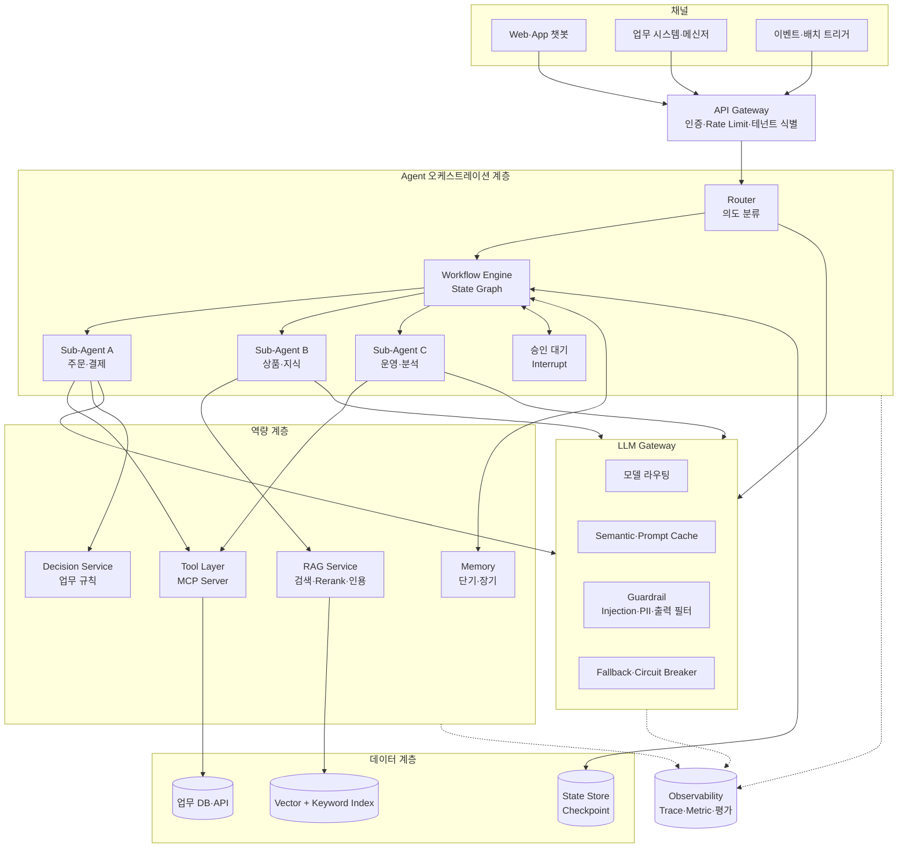
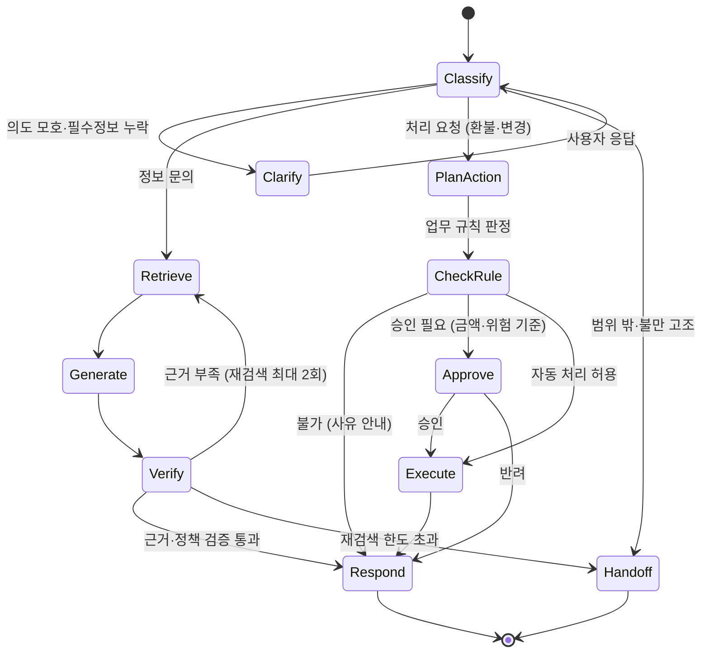
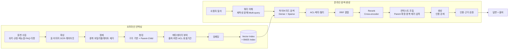
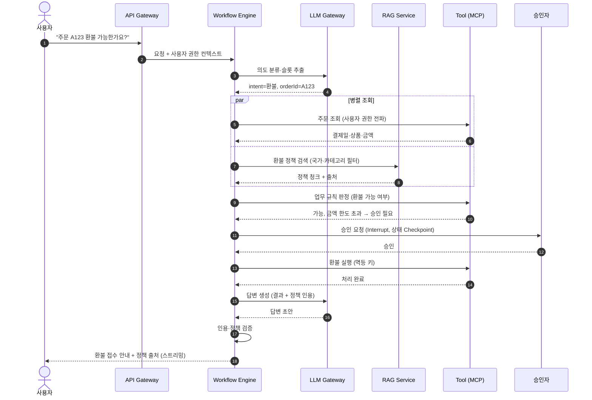

# AI Agent 워크플로우 설계 및 LLM/RAG 파이프라인 아키텍처

## 1. 핵심 요약

AI Agent는 **LLM(추론) + Tool(행동) + Memory(상태) + Control Loop(제어)**의 결합입니다. 엔터프라이즈 환경에서 Agent의 성패는 모델의 자율성보다 **제어 가능성**에 달려 있습니다. 따라서 본 설계는 "예측 가능한 부분은 워크플로우로 고정하고, 불확실한 부분에만 자율 추론을 허용"하는 구조를 기본으로 합니다.

| 구분 | 설계 방향 |
|---|---|
| 워크플로우 | 상태 그래프(State Graph) 기반 오케스트레이션. 노드·분기·루프 상한·체크포인트·사람 개입 지점을 명시 |
| 도구 | MCP 등 표준 프로토콜로 도구 계층 분리. 읽기·쓰기 분리, 호출자 권한 전파, 쓰기 도구는 승인 후 실행 |
| RAG | 오프라인 인덱싱(구조 기반 청킹·메타데이터·ACL)과 온라인 검색(쿼리 재작성·하이브리드 검색·Rerank·인용 검증)을 분리 설계 |
| LLM 게이트웨이 | 모델 라우팅·캐시·Fallback·Guardrail·비용 통제를 단일 계층으로 집약 |
| 평가·관측 | RAG 지표(Context Precision/Recall, Faithfulness)와 Agent 지표(과업 성공률, 도구 호출 정확도, 스텝·비용)를 Trace 기반으로 상시 측정 |

---

## 2. Agent 구조 선택 기준

### 2.1 워크플로우형과 자율형

| 구분 | 워크플로우형(Workflow) | 자율형(Autonomous Agent) |
|---|---|---|
| 제어 주체 | 개발자가 정의한 그래프 | LLM이 매 스텝 다음 행동 결정 |
| 예측 가능성 | 높음 | 낮음 |
| 적합 과업 | 절차가 정해진 업무(문의 분류·답변, 문서 변환, 승인 처리) | 탐색형 과업(장애 원인 분석, 코드 수정, 리서치) |
| 리스크 | 유연성 부족 | 무한 루프, 비용 폭증, 의도 밖 행동 |
| 통제 수단 | 분기 조건, 검증 노드 | 스텝·토큰 예산, 도구 화이트리스트, 승인 지점 |

실무 설계는 **하이브리드**를 권장합니다. 전체 흐름은 워크플로우로 고정하고, 특정 노드 내부에서만 ReAct 루프(추론 → 도구 호출 → 관찰 반복)를 허용하며 그 루프에 상한을 둡니다.

### 2.2 주요 워크플로우 패턴

| 패턴 | 구조 | 사용 예 |
|---|---|---|
| Prompt Chaining | 단계별 LLM 호출을 직렬 연결, 단계 사이 검증 | 요건 문서 → 구조화 → 설계서 생성 |
| Routing | 의도 분류 후 전문 처리 경로로 분기 | 고객 문의를 주문·배송·환불 Agent로 분기 |
| Parallelization | 독립 하위 작업 동시 실행 후 병합(Fan-out/Fan-in) | 여러 데이터 소스 동시 조회 후 종합 |
| Orchestrator-Worker | 상위 Agent가 계획 수립, 하위 Agent에 위임 | 장애 분석: 로그·지표·배포이력 담당 Agent 분업 |
| Evaluator-Optimizer | 생성 → 평가 → 개선 반복 | 답변 품질 기준 충족 시까지 재작성(최대 N회) |
| Human-in-the-loop | 특정 노드에서 실행 중단, 사람 승인 후 재개 | 환불 실행, 데이터 변경, 외부 발송 |

---

## 3. 전체 아키텍처

| 계층 | 책임 | 비고 |
|---|---|---|
| API Gateway | 인증, 사용자·테넌트 컨텍스트 생성, Rate Limit | Agent 내부로 권한 컨텍스트를 전파하는 시작점 |
| 오케스트레이션 | 상태 그래프 실행, 분기·루프·병렬, 체크포인트, 사람 개입 | Stateless 실행 + 외부 State Store로 수평 확장 |
| 역량 | RAG·도구·메모리·규칙 판정을 서비스로 제공 | Agent는 역량을 "호출"만 하고 구현을 소유하지 않음 |
| LLM Gateway | 모델 추상화, 비용·안전·가용성 통제 | 모든 LLM 호출의 단일 출입구 |
| Observability | Trace, 지표, 온라인 평가 | 요청 → 노드 → LLM·도구 호출을 단일 Trace ID로 연결 |

---

## 4. Agent 워크플로우 상세 설계

### 4.1 상태 그래프 설계 예시: 고객 문의 처리 Agent

### 4.2 상태(State) 설계

그래프 노드 간에 공유하는 상태를 명시적 스키마로 정의합니다. 대화 문자열 전체를 넘기는 방식은 토큰 낭비와 정보 손실을 유발하므로 지양합니다.

| 필드 | 내용 |
|---|---|
| `requestId`, `userId`, `tenantId` | 추적·권한 컨텍스트 |
| `intent`, `slots` | 분류된 의도와 추출된 엔티티(주문번호, 상품, 기간) |
| `retrievedDocs` | 검색 근거(문서 ID, 청크, 점수) |
| `toolResults` | 도구 호출 결과 요약 |
| `draftAnswer`, `citations` | 생성 답변과 인용 |
| `loopCount`, `tokenUsed` | 루프·예산 통제 값 |
| `pendingApproval` | 사람 승인 대기 정보 |

### 4.3 제어 장치

| 장치 | 설계 |
|---|---|
| 루프 상한 | 재검색·재작성·ReAct 반복에 최대 횟수 지정, 초과 시 정해진 탈출 경로(Handoff) |
| 예산 | 요청당 토큰·비용·시간 상한, 초과 시 현재까지 결과로 종료 |
| 체크포인트 | 노드 완료마다 상태 저장. 장애 후 마지막 노드부터 재개, 사람 승인 대기 중 장시간 보존 |
| 멱등성 | 쓰기 도구 호출에 멱등 키 부여, 재개·재시도 시 중복 실행 방지 |
| 사람 개입(Interrupt) | 쓰기·고위험 노드 직전 실행 중단, 승인 결과를 상태에 반영 후 재개 |
| 장시간 작업 | 즉시 `jobId` 응답 후 비동기 실행, 진행 상황은 SSE·WebSocket·콜백으로 푸시 |

### 4.4 Multi-Agent 협업 설계

Orchestrator-Worker 구조에서 하위 Agent는 **좁은 책임과 전용 도구 세트**를 갖습니다. 상위 Agent는 계획과 결과 종합만 담당하며, 하위 Agent에게는 전체 대화가 아닌 **과업 명세(목표·입력·출력 스키마·제약)**만 전달합니다. 하위 Agent 간 직접 통신은 금지하고 상위 Agent를 통해서만 정보를 교환해 흐름 추적성을 유지합니다.

---

## 5. 도구(Tool) 계층 설계

| 설계 항목 | 기준 |
|---|---|
| 표준 프로토콜 | MCP(Model Context Protocol) 등으로 도구를 Agent 코드와 분리, 여러 Agent가 재사용 |
| 도구 명세 | 용도·사용 조건·인자 의미를 명확히 서술. 범용 도구 1개보다 목적별 좁은 도구 여러 개가 호출 정확도가 높음 |
| 읽기·쓰기 분리 | 조회 도구와 변경 도구를 분리하고, 변경 도구는 승인 노드 뒤에서만 호출 가능 |
| 권한 전파 | 도구 호출 시 서비스 계정이 아닌 **요청 사용자의 권한 범위**를 헤더로 전달(On-behalf-of), 도구 서버가 최종 강제 |
| 결과 제한 | 응답 크기 상한, 페이지네이션, 요약 반환으로 컨텍스트 오염 방지 |
| 안전 실행 | 타임아웃, 재시도 정책, SQL 등 위험 도구는 읽기 전용 계정·쿼리 화이트리스트·샌드박스 |
| 오류 표현 | 도구 오류를 LLM이 이해 가능한 구조화 메시지로 반환해 재계획 가능하도록 함 |

---

## 6. RAG 파이프라인 아키텍처

### 6.1 전체 흐름

### 6.2 인덱싱 설계

| 항목 | 설계 기준 |
|---|---|
| 파싱 | 문서 구조(제목·목록·표)를 보존. 표는 행 단위 텍스트화 또는 Markdown 표로 변환, 이미지는 OCR·캡션 생성 |
| 청킹 | 고정 길이 분할 대신 **문서 구조(섹션) 기반 분할**을 우선. 검색은 작은 Child 청크(200~400 토큰)로, 생성은 상위 Parent 섹션으로 확장해 문맥 손실 방지 |
| 문맥 보강 | 각 청크 앞에 문서 제목·섹션 경로·요약을 덧붙여 임베딩(Contextual Chunk)해 단독 청크의 의미 모호성 해소 |
| 메타데이터 | 출처 URL, 문서 버전, 작성·수정일, 유효기간, 조직·국가·상품 범위, **접근 권한(ACL)** |
| 증분 갱신 | 원천 변경을 CDC·Webhook으로 감지, 콘텐츠 해시 비교로 변경 청크만 재임베딩, 원천 삭제 시 인덱스 삭제 전파 |
| 임베딩 버전 | 임베딩 모델 교체 시 신규 인덱스를 병행 구축 후 평가 통과 시 전환(Blue-Green) |

### 6.3 검색 설계

| 단계 | 기법 | 목적 |
|---|---|---|
| 쿼리 재작성 | 대화 이력을 반영한 독립 질의 생성(지시어 해소), 약어·동의어 확장 | 다회차 대화에서 검색 누락 방지 |
| 쿼리 분해 | 복합 질문을 하위 질의로 분리 후 병렬 검색 | 다중 근거 질문 대응 |
| 하이브리드 검색 | Dense(의미) + BM25(키워드·코드·모델명) 병행 | 고유명사·코드 검색 누락 보완 |
| 사전 필터 | ACL·유효기간·범위 메타데이터로 검색 전 필터링 | 권한 밖 문서 노출 원천 차단 |
| 결과 결합 | RRF(Reciprocal Rank Fusion) | 점수 척도가 다른 검색 결과 통합 |
| Rerank | Cross-encoder로 질의-청크 관련도 재평가, 상위 K개 선택 | 정밀도 향상, 컨텍스트 노이즈 감소 |
| 컨텍스트 압축 | 중복 제거, 질의 무관 문장 제거, 토큰 예산 내 배치 | 비용 절감, "중간 정보 유실" 완화 |

ACL 필터는 반드시 **검색 단계(사전 필터)**에서 적용합니다. 검색 후 LLM에게 "권한 없는 내용은 답하지 말라"고 지시하는 방식은 강제력이 없어 정보 유출로 이어질 수 있습니다.

### 6.4 생성과 근거 검증

- 프롬프트에 "제공된 문서에 근거가 없으면 모른다고 답할 것"과 "문장별 출처 번호 표기"를 명시합니다.
- 생성 후 인용 번호가 실제 컨텍스트 청크와 대응하는지, 답변 핵심 주장이 해당 청크에 포함되는지 검증합니다(NLI 모델 또는 LLM Judge).
- 검증 실패 시 재검색·재생성(최대 N회) 후에도 실패하면 "확인 불가"와 담당 부서 안내로 응답합니다.

### 6.5 고도화 RAG 패턴

| 패턴 | 내용 | 적용 조건 |
|---|---|---|
| Agentic RAG | Agent가 검색 필요 여부·검색 대상·반복 여부를 스스로 결정 | 다단계 추론이 필요한 질의 |
| Corrective RAG | 검색 결과 관련도를 평가해 부족하면 쿼리 변경·다른 소스 검색 | 검색 품질 편차가 큰 도메인 |
| GraphRAG | 엔티티·관계 그래프 구축 후 관계 기반 탐색 | 조직·상품·시스템 간 관계 질의 |
| Structured RAG(Text-to-SQL) | 정형 데이터는 벡터 검색 대신 SQL·API 조회 | 수치·집계·실시간 데이터 질의 |

정형·실시간 데이터(재고, 가격, 주문 상태)는 RAG가 아니라 **도구 호출로 원천 시스템을 직접 조회**하는 것이 원칙입니다. 인덱스에 적재된 수치는 즉시 낡은 정보가 되기 때문입니다.

---

## 7. 요청 처리 시퀀스

---

## 8. LLM Gateway 설계

| 기능 | 설계 |
|---|---|
| 모델 라우팅 | 분류·추출 등 단순 작업은 소형 모델, 추론·생성은 대형 모델. 난이도 분류기 또는 규칙으로 라우팅 |
| 캐시 | Prompt Cache(고정 시스템 프롬프트 접두부 재사용), Semantic Cache(유사 질의 응답 재사용, 개인화·실시간 응답은 제외) |
| 가용성 | 공급사·리전 이중화, Circuit Breaker, 대체 모델 Fallback |
| 입력 Guardrail | 직접·간접 프롬프트 인젝션 탐지(검색 문서 내 지시문 포함), PII 마스킹 |
| 출력 Guardrail | 구조화 출력 검증, 유해·금칙 표현 필터, 개인정보 유출 검사 |
| 비용 통제 | 사용자·테넌트·기능별 토큰 계량, 예산 초과 알림·차단 |
| 공통 관측 | 모든 호출의 모델·토큰·지연·오류를 Trace에 기록 |

---

## 9. 메모리 설계

| 유형 | 내용 | 저장·관리 |
|---|---|---|
| 작업 메모리 | 현재 과업의 중간 결과, 계획 | 그래프 State |
| 단기 메모리 | 세션 대화 이력 | 최근 N턴 원문 + 이전 구간 요약 압축, TTL |
| 장기 메모리 | 사용자 선호, 과거 처리 이력 | 별도 저장소, 사용자 동의·삭제 요청 대응 |
| 절차 메모리 | 성공한 처리 사례 | Few-shot 예시 저장소, 검증 후 등록 |

컨텍스트 창은 "많이 넣을수록 좋다"가 아니라 **관련성 높은 정보를 적게 넣을수록 정확도가 높아지는** 경향이 있으므로, 메모리 주입도 검색·선별 대상으로 다룹니다.

---

## 10. 평가와 관측

### 10.1 평가 지표

| 대상 | 지표 | 의미 |
|---|---|---|
| 검색 | Context Precision / Recall, MRR, nDCG | 정답 근거를 상위에 가져왔는가 |
| 생성 | Faithfulness, Answer Relevancy, 인용 정확도 | 근거에 충실하고 질문에 맞는가 |
| Agent | 과업 성공률, 도구 선택·인자 정확도, 평균 스텝 수 | 목표를 올바른 경로로 달성했는가 |
| 안전 | 인젝션 방어율, 권한 밖 정보 노출 건수 | 보안 통제가 동작하는가 |
| 비기능 | TTFT, 응답 p95, 요청당 비용 | 사용자 경험·운영 비용 |
| 사용자 | 해결률, 상담 이관률, 피드백 점수 | 실제 업무 효과 |

### 10.2 평가 운영

- **오프라인**: 질의-정답-정답 근거로 구성한 평가셋으로 검색·생성·Agent 경로를 분리 평가합니다. 프롬프트·모델·청킹·임베딩 변경 시 CI에서 회귀 평가를 자동 수행합니다.
- **온라인**: 운영 트래픽 일부를 LLM Judge로 샘플 평가하고, 사용자 피드백·이관 사유를 수집해 평가셋을 보강합니다.
- **Trace**: OpenTelemetry 계열 표준으로 요청 → 그래프 노드 → LLM·검색·도구 호출을 계층 Span으로 기록해, 오답 발생 시 "검색 실패인지, 생성 실패인지, 도구 오류인지"를 즉시 구분합니다.

---

## 11. 보안 설계

| 위협 | 대응 |
|---|---|
| 직접 프롬프트 인젝션 | 시스템 지시와 사용자 입력 구획 분리, 입력 분류기 탐지 |
| 간접 프롬프트 인젝션 | 검색 문서·도구 결과를 "데이터"로 표시하고 그 안의 지시 무시, 쓰기 도구는 승인 필수 |
| 권한 상승 | 도구 서버가 사용자 권한으로 최종 강제, Agent 프롬프트에 권한 판단을 위임하지 않음 |
| 정보 유출 | 검색 사전 ACL 필터, 출력 PII 검사, 로그 마스킹 |
| 과도한 행동 | 도구 화이트리스트, 스텝·비용 상한, 위험 행동 사람 승인 |
| 공급망 | 외부 MCP 서버·플러그인 검증, 버전 고정 |

---

## 12. 비기능 설계

| 항목 | 설계 |
|---|---|
| 지연 예산 | 의도 분류 300ms, 검색 300ms, Rerank 200ms, 생성 첫 토큰 1초 이내. 스트리밍으로 체감 지연 단축 |
| 확장성 | 오케스트레이터 Stateless화, 상태·세션은 Redis·DB Checkpoint로 외부화해 수평 확장 |
| 멀티테넌시 | 테넌트별 인덱스 네임스페이스·ACL·예산·모델 정책 분리 |
| 가용성 | LLM·벡터 DB 이중화, 장애 시 FAQ 정적 응답·상담 이관으로 성능 저하 운영 |
| 운영성 | 프롬프트·그래프·도구 명세를 버전 관리하고 평가 게이트 통과 후 배포 |

---

## 13. 기대 효과

| 관점 | 효과 |
|---|---|
| 신뢰성 | 상태 그래프·루프 상한·승인 지점으로 Agent 행동 예측 가능, 장애 시 체크포인트 재개 |
| 정확성 | 하이브리드 검색·Rerank·인용 검증으로 근거 기반 답변, 실시간 데이터는 도구로 원천 조회 |
| 보안 | 검색 사전 ACL과 도구 서버 권한 강제로 권한 밖 정보·행동 차단 |
| 비용 | 모델 라우팅·캐시·컨텍스트 압축으로 요청당 비용 절감 |
| 확장성 | 역량(RAG·도구·규칙)을 서비스로 분리해 신규 Agent를 조립 방식으로 추가 |

엔터프라이즈 Agent는 "똑똑한 모델"이 아니라 **통제된 워크플로우, 근거 기반 검색, 권한이 강제되는 도구, 측정 가능한 평가 체계**의 조합으로 완성됩니다.
