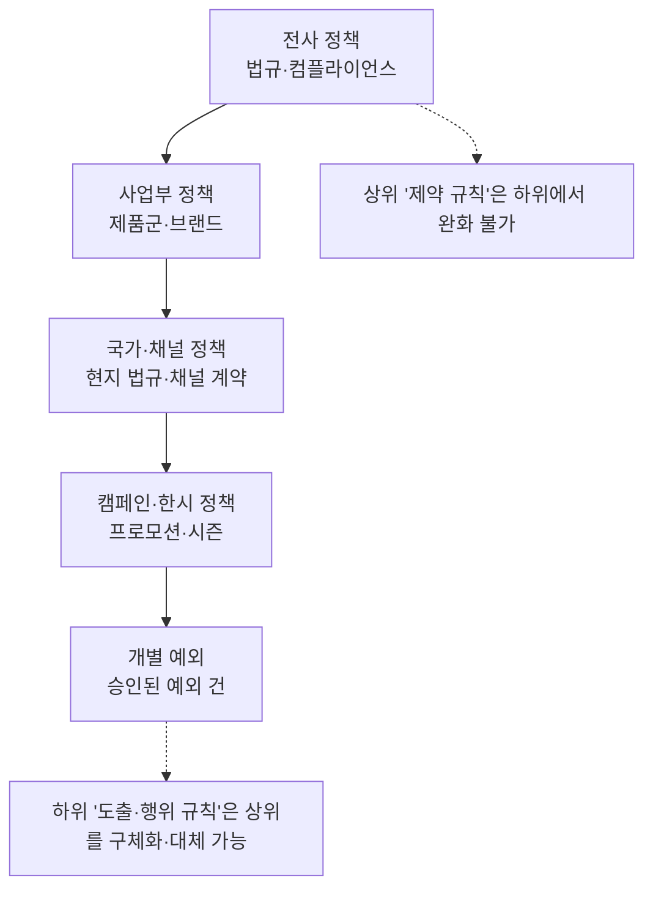
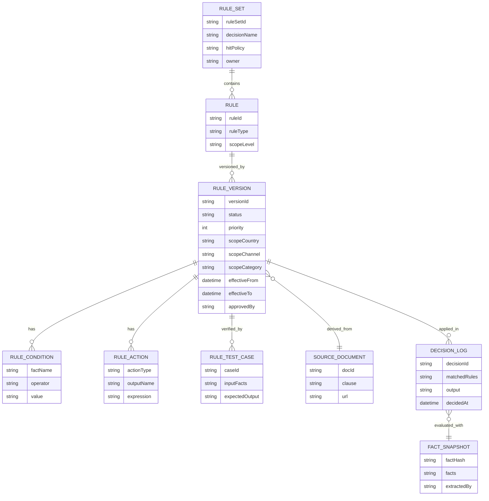
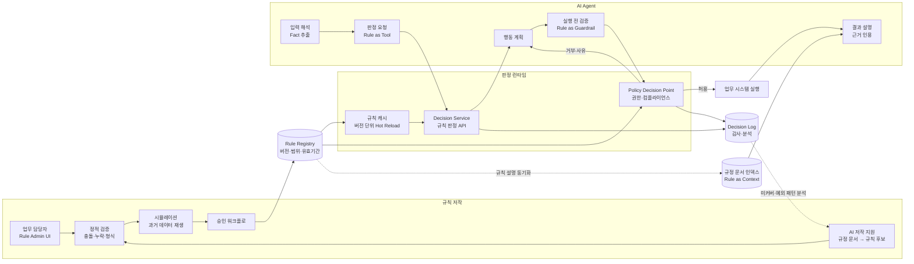
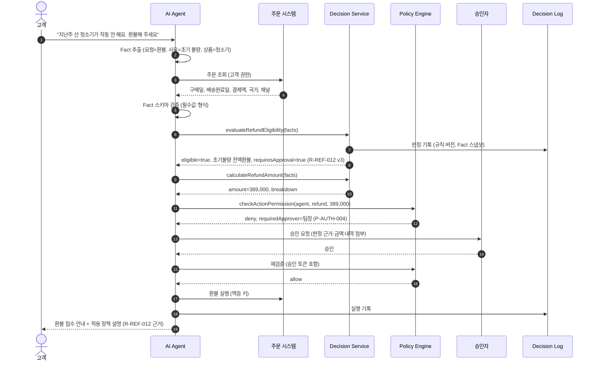
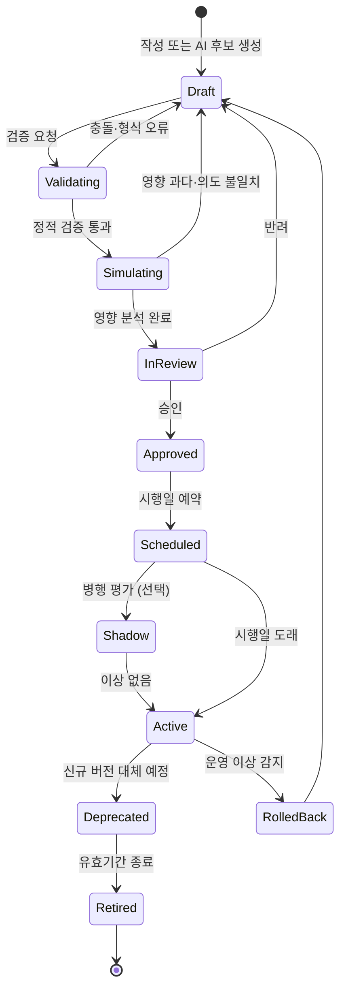

# 비즈니스 규칙 체계와 AI Agent 연동 설계

## 1. 핵심 요약

기업의 의사결정은 정책·규정·계약 조건에 따라 이루어지며, 이는 **일관성·재현성·감사 가능성**이 필수입니다. 반면 LLM은 규칙을 정확히 기억하거나 매번 동일하게 적용하는 것을 보장하지 못합니다. 따라서 본 설계의 기본 원칙은 다음과 같습니다.

> **규칙의 정본(Source of Truth)과 판정은 결정론 엔진이 담당하고, AI Agent는 비정형 입력을 해석해 규칙 엔진의 입력(Fact)을 만들고, 판정 결과를 설명·실행하는 역할을 담당합니다.**

| 구분 | 설계 방향 |
|---|---|
| 규칙 체계 | 규칙 유형 분류(제약·도출·행위·권한)와 적용 범위 계층(전사 → 사업부 → 국가·채널 → 예외), 우선순위·유효기간 메타모델 |
| 규칙 관리 | Rule Registry에서 버전·승인·시뮬레이션·배포·폐기를 생애주기로 관리 |
| 연동 패턴 | Rule as Tool(판정 호출), Rule as Guardrail(실행 전 정책 검증), Rule as Context(설명용 주입), Rule as Router(흐름 분기), AI 기반 규칙 저작 지원 |
| 품질 보장 | Fact 추출 검증, 규칙 충돌·누락 탐지, 과거 데이터 재생 시뮬레이션 |
| 설명가능성 | 모든 판정에 적용 규칙 ID·버전·입력 Fact 기록, AI는 이 기록에 근거해 자연어 설명 생성 |

---

## 2. 문제 정의

### 2.1 규칙을 프롬프트에만 두었을 때의 문제

| 문제 | 현상 |
|---|---|
| 비일관 적용 | 같은 조건에서 승인과 거절이 번갈아 발생 |
| 수치 오류 | 기간·금액 경계 계산 착오(예: 30일 이내 판단 오류) |
| 규칙 충돌 미해결 | 국가 규칙과 프로모션 규칙이 상충할 때 임의 선택 |
| 변경 반영 지연 | 규정 변경 시 프롬프트 수정 누락, 적용 시점 통제 불가 |
| 감사 불가 | "왜 이 결정이 나왔는가"를 규정 조항 단위로 설명할 수 없음 |
| 보안 우회 | 프롬프트 인젝션으로 규칙 무시 유도 가능 |

### 2.2 규칙만으로 처리할 때의 한계

규칙 엔진은 정형 입력을 전제로 하므로, 고객 문의·첨부 이미지·상담 기록 같은 비정형 입력을 처리하지 못합니다. 또한 규칙이 다루지 않는 예외 상황에 대한 판단 보조와 결정 사유의 자연어 설명이 어렵습니다. **두 방식은 대체 관계가 아니라 상호 보완 관계**입니다.

### 2.3 역할 분담

| 영역 | 담당 | 예시 |
|---|---|---|
| 판정 기준 | 규칙 엔진 | 환불 가능 기간, 할인 한도, 승인 권한 금액, 국가별 법적 제약 |
| 계산 | 규칙 엔진 | 환불 금액, 수수료, 포인트 차감 |
| 권한·컴플라이언스 | 정책 엔진 | 역할별 실행 가능 행위, 개인정보 처리 제약 |
| 비정형 해석 | AI Agent | 문의에서 주문번호·사유·요청 유형 추출, 이미지 하자 분류 |
| 예외 판단 보조 | AI Agent + 사람 | 규칙 미적용 사례의 유사 사례 검색·권고안 작성 |
| 설명·커뮤니케이션 | AI Agent | 판정 결과와 규정 근거를 고객 언어로 설명 |
| 규칙 저작 지원 | AI Agent + 사람 승인 | 규정 문서에서 규칙 후보 추출, 충돌 탐지 |

---

## 3. 비즈니스 규칙 체계

### 3.1 규칙 유형 분류

| 유형 | 정의 | 예시 |
|---|---|---|
| 용어·구조 규칙 | 업무 개념과 관계 정의 | "VIP 고객은 최근 12개월 구매액 500만 원 이상" |
| 제약 규칙(Constraint) | 반드시 만족해야 하는 조건 | "할인율은 정가의 50%를 초과할 수 없다" |
| 도출 규칙(Derivation) | 입력으로부터 값을 계산·추론 | "환불액 = 결제액 − 사용 쿠폰 − 반품 배송비" |
| 행위 규칙(ECA) | 이벤트 발생 시 조건 충족하면 행동 | "결제 실패 3회 시 계정 일시 잠금" |
| 권한 규칙 | 주체·행위·자원·조건에 대한 허용 | "상담원은 10만 원 이하 환불만 직접 승인" |
| 라우팅 규칙 | 처리 경로·담당자 결정 | "고액·반복 환불은 리스크팀 검토" |

### 3.2 적용 범위 계층과 우선순위

충돌 해결 전략은 규칙 세트 단위로 명시합니다.

| 전략 | 내용 | 적용 |
|---|---|---|
| 상위 우선 강제 | 법규·컴플라이언스 제약은 하위 규칙이 무효화할 수 없음 | 제약·권한 규칙 |
| 구체성 우선(Most Specific) | 적용 범위가 더 좁은 규칙 우선 | 국가·상품별 도출 규칙 |
| 명시 우선순위 | 규칙에 지정된 Priority 값 순 | 프로모션 중첩 |
| 최초 일치(First Hit) | 결정 테이블 상단부터 첫 일치 규칙 적용 | 단순 분류 |
| 전체 수집(Collect) | 일치 규칙 결과를 모두 수집해 합산·최댓값 선택 | 할인·포인트 누적 |

### 3.3 규칙 표현 방식 선택

| 방식 | 특징 | 적합 영역 |
|---|---|---|
| 결정 테이블(DMN) | 조건 열 × 결과 열 표 형식, 업무 담당자가 이해·수정 가능 | 분류·자격·요율 판정 |
| 규칙 엔진 DSL(Drools 등) | 복합 조건·추론 체인 표현 | 다단계 추론, 대량 Fact 평가 |
| 정책 코드(OPA Rego, Cedar) | 권한·접근 정책 선언형 표현, 정책 결정 지점(PDP) 표준 | 권한·컴플라이언스 |
| JSON Logic·설정형 규칙 | 경량, 런타임 수정 용이 | 단순 임계값·플래그 |
| 코드 내 구현 | 성능·복잡도 높은 계산 | 핵심 가격 엔진 등 변경 빈도 낮은 로직 |

선택 기준은 **변경 주체(업무 담당자 vs 개발자), 변경 빈도, 표현 복잡도, 감사 요구 수준**입니다. 변경이 잦고 업무 담당자가 관리해야 하는 규칙은 결정 테이블로 외부화합니다.

---

## 4. 규칙 메타모델

| 메타 항목 | 목적 |
|---|---|
| 적용 범위(국가·채널·카테고리) | 하나의 규칙 세트로 다국가·다채널 운영 |
| 유효기간 | 프로모션·법규 시행일 기준 자동 적용·종료 |
| 근거 문서·조항 | 규칙과 원본 규정의 추적성, AI 설명 시 인용 근거 |
| 상태·승인자 | 승인되지 않은 규칙의 운영 반영 차단 |
| 테스트 케이스 | 규칙 변경 시 회귀 검증 |
| 판정 로그 | 감사, 재현, 영향도 분석 |

---

## 5. 전체 아키텍처

---

## 6. AI Agent 연동 패턴

### 6.1 패턴 개요

| 패턴 | 동작 | 강제력 | 사용처 |
|---|---|---|---|
| Rule as Tool | Agent가 Fact를 구성해 Decision Service 호출, 판정 결과를 그대로 사용 | 강함 | 자격 판정, 금액 계산, 승인 필요 여부 |
| Rule as Guardrail | Agent가 계획한 행동을 실행 직전 정책 엔진이 검증, 거부 시 사유 반환 | 강함 | 데이터 변경, 환불·발송 등 쓰기 행위 |
| Rule as Router | 규칙 판정 결과가 워크플로 분기·승인 단계·담당 Agent 결정 | 강함 | 위험도별 승인 레벨, 처리 부서 배정 |
| Rule as Context | 관련 규정·규칙 설명을 검색해 프롬프트에 주입 | 약함(참고용) | 고객 안내, 정책 질의응답 |
| AI-assisted Authoring | 규정 문서·운영 로그에서 규칙 후보·충돌을 AI가 제안, 사람이 승인 | 승인 후 강함 | 규칙 저작·유지보수 |

**판정이 필요한 곳에는 Rule as Context를 단독 사용하지 않습니다.** 프롬프트에 규칙을 넣는 것은 설명 품질을 높이는 수단이지, 판정 일관성을 보장하는 수단이 아닙니다.

### 6.2 Rule as Tool: 판정 도구 설계

Decision Service는 Agent가 호출할 수 있는 도구로 노출하며, 범용 "규칙 실행" 도구가 아니라 **결정 단위(Decision)별 좁은 도구**로 제공합니다.

| 도구 | 입력 Fact | 출력 |
|---|---|---|
| `evaluateRefundEligibility` | 국가, 채널, 카테고리, 구매일, 배송완료일, 사용 여부, 사유 코드 | `eligible`, `refundType`, `requiresApproval`, `matchedRules[]`, `reasonCodes[]` |
| `calculateRefundAmount` | 결제 내역, 쿠폰, 배송비 정책 | `amount`, `breakdown[]`, `matchedRules[]` |
| `checkActionPermission` | 실행 주체 역할, 행위, 대상, 금액 | `allow`, `denyReason`, `requiredApprover` |

출력에는 판정값과 함께 **매칭된 규칙 ID·버전과 사유 코드**를 반드시 포함해, Agent가 설명을 생성할 때 임의 사유를 만들지 않고 규칙 근거를 인용하도록 합니다.

### 6.3 Rule as Guardrail: 실행 전 정책 검증

Agent가 계획한 모든 쓰기 행동은 도구 실행 계층의 **정책 강제 지점(PEP)**을 통과해야 하며, 판정은 정책 결정 지점(PDP)이 수행합니다. Agent 프롬프트에 "권한 밖 행동은 하지 말라"고 지시하는 것은 보조 수단일 뿐이며, 최종 강제는 반드시 Agent 외부에서 이루어집니다.

### 6.4 연동 시퀀스: 환불 요청 처리

---

## 7. Fact 추출 품질 보장

규칙 엔진은 결정론적이므로 **입력 Fact가 틀리면 결과도 정확하게 틀립니다.** 따라서 AI 연동의 품질 핵심은 Fact 추출입니다.

| 장치 | 설계 |
|---|---|
| Fact 스키마 | 결정 단위별 입력 스키마(타입·Enum·필수 여부·허용 범위)를 Decision Service가 공개하고, Agent는 이 스키마로 구조화 출력 |
| 원천 우선 | 날짜·금액·상태 등 원천 시스템에 있는 값은 LLM 추출이 아니라 **도구 조회 값**을 사용. LLM은 원천에 없는 정보(사유, 의도)만 추출 |
| 근거 범위 | 추출 Fact마다 원문 근거 구간(Span)을 함께 기록해 검토·감사에 활용 |
| 누락 시 되묻기 | 필수 Fact가 없거나 모호하면 추정하지 않고 사용자에게 확인 질문 |
| 추출 신뢰도 | 사유 분류 등 해석 Fact의 신뢰도가 낮으면 사람 검토로 전환 |
| 정규화 | 사유 자유 서술을 표준 사유 코드로 매핑(코드 목록 안에서만 선택) |

---

## 8. 규칙 품질 관리

### 8.1 정적 검증

| 검사 | 내용 |
|---|---|
| 충돌 탐지 | 동일 조건 영역에서 상이한 결과를 내는 규칙 쌍 식별 |
| 중복 탐지 | 조건·결과가 동일한 규칙, 상위 규칙에 포함되어 효과 없는 규칙 |
| 커버리지 분석 | 입력 공간 중 어떤 규칙에도 해당하지 않는 영역 탐지 → 기본 규칙 또는 사람 검토 경로 지정 |
| 상위 제약 위반 | 하위 규칙이 전사 제약 규칙을 완화하는지 검사 |
| 형식 검증 | Fact 이름·타입·연산자 유효성, 유효기간 중첩 |

### 8.2 변경 영향 시뮬레이션

규칙 변경 시 과거 일정 기간의 실제 Fact 스냅샷(Decision Log)을 신·구 규칙으로 각각 재평가(Backtesting)해 판정이 달라지는 건수·금액·대상 고객군을 산출합니다. 승인자는 이 결과를 보고 배포 여부를 결정합니다.

### 8.3 AI 기반 규칙 개선

- **규칙 후보 추출**: 신규·개정 규정 문서에서 조건·결과·적용 범위를 추출해 결정 테이블 초안을 생성하고, 원문 조항을 근거로 연결합니다.
- **미커버 패턴 탐지**: 사람 검토로 넘어간 건과 예외 승인 건을 군집 분석해, 반복되는 예외를 신규 규칙 후보로 제안합니다.
- **충돌 설명**: 정적 검증에서 탐지된 충돌을 업무 담당자가 이해할 수 있는 문장과 예시 케이스로 설명합니다.

AI가 만든 규칙은 어떤 경우에도 **사람 승인과 테스트 케이스 통과 없이 운영에 반영하지 않습니다.**

---

## 9. 규칙 생애주기

| 단계 | 통제 |
|---|---|
| Draft | 근거 문서 조항 연결 필수 |
| Validating | 정적 검증 자동 실행, 테스트 케이스 전부 통과 |
| Simulating | 과거 데이터 재생 결과 첨부 |
| InReview | 규칙 소유 부서 + 영향 범위에 따라 컴플라이언스 승인 |
| Shadow | 신규 규칙을 실판정과 병행 평가하되 결과는 미반영, 불일치 건 검토 |
| Active | 버전 단위 배포, 런타임 캐시 Hot Reload, 판정 로그에 버전 기록 |
| RolledBack | 직전 버전 즉시 복귀, 원인 분석 후 재작성 |

---

## 10. 설명가능성과 감사

모든 판정은 다음 정보를 Decision Log에 기록합니다.

| 항목 | 내용 |
|---|---|
| 판정 ID·시각 | 추적 키 |
| Fact 스냅샷 | 입력 Fact 전체와 출처(도구 조회 / AI 추출 + 근거 구간) |
| 규칙 세트 버전 | 판정 시점에 적용된 버전 |
| 매칭 규칙 | 적용된 규칙 ID·버전, 충돌 해결 결과 |
| 판정 결과·사유 코드 | 결정값과 사유 |
| 실행 정보 | 실행 주체(Agent·사람), 승인 이력 |

AI Agent의 설명은 이 기록을 입력으로 생성하며, **판정 로그에 없는 사유를 생성하지 않도록** 사유 코드와 규칙 근거 문서만 인용하게 제한합니다. 이를 통해 고객 안내, 내부 감사, 규제 기관 대응에서 동일한 근거로 설명할 수 있습니다.

---

## 11. 적용 예시: 커머스 환불 결정 테이블

| # | 국가 | 카테고리 | 배송완료 후 경과일 | 사유 | 사용 여부 | 결과 | 승인 필요 | 근거 |
|---|---|---|---|---|---|---|---|---|
| 1 | 전체 | 전체 | — | 초기 불량 | — | 전액 환불 | 금액 > 30만 원 | 품질보증 정책 3.1 |
| 2 | 한국 | 전체 | ≤ 7일 | 단순 변심 | 미사용 | 환불(왕복 배송비 차감) | 아니오 | 전자상거래법 제17조 |
| 3 | EU | 전체 | ≤ 14일 | 단순 변심 | 미사용 | 전액 환불 | 아니오 | 소비자권리지침 |
| 4 | 전체 | 맞춤 제작 | — | 단순 변심 | — | 환불 불가 | — | 판매 약관 7조 |
| 5 | 전체 | 전체 | 기간 초과 | 단순 변심 | — | 환불 불가, 상담 이관 안내 | — | 판매 약관 5조 |
| 6 | 그 외 | — | — | — | — | 사람 검토 | 예 | 기본 규칙 |

- 결정 테이블 적중 정책: 제약성 규칙(4번)을 우선 평가하고, 이후 구체성 우선으로 적용합니다.
- 마지막 행은 커버리지 공백을 메우는 기본 규칙이며, 해당 건은 미커버 패턴 분석 대상으로 수집됩니다.
- AI Agent는 고객 메시지와 첨부 사진으로 `사유`와 `사용 여부`만 추출하고, 국가·카테고리·경과일은 주문 시스템 조회 값을 사용합니다.

---

## 12. 비기능 설계

| 항목 | 설계 |
|---|---|
| 성능 | 규칙 세트를 메모리에 컴파일·캐시, 판정 p95 50ms 이내 목표 |
| 일관성 | 한 요청 처리 중에는 동일 규칙 세트 버전을 고정 사용 |
| 가용성 | Decision Service 이중화, 장애 시 Agent는 판정 없이 실행하지 않고 보류·상담 이관 |
| 보안 | 규칙 변경 권한 분리(작성자 ≠ 승인자), 변경 이력 불변 저장 |
| 다국가 확장 | 범위 메타데이터로 국가·채널 규칙 추가, 공통 규칙 재사용 |

---

## 13. 기대 효과

| 관점 | 효과 |
|---|---|
| 일관성 | 동일 조건 동일 판정 보장, 국가·채널별 정책을 단일 체계로 운영 |
| 민첩성 | 업무 담당자가 결정 테이블로 정책 변경, 시뮬레이션·승인 후 즉시 반영 |
| 자동화 확대 | AI가 비정형 입력을 Fact로 변환해 기존에 사람이 처리하던 판정 업무 자동화 |
| 리스크 통제 | 정책 엔진의 실행 전 검증으로 Agent의 권한 밖 행동·규정 위반 차단 |
| 감사 대응 | 판정마다 규칙 버전·근거 조항·입력 Fact 추적 가능 |
| 지속 개선 | 예외·미커버 패턴을 AI가 분석해 규칙 후보로 환류 |

비즈니스 규칙과 AI Agent의 결합은 **"AI가 규칙을 대신하는 구조"가 아니라 "규칙이 AI의 판단 경계를 정하고, AI가 규칙의 적용 범위를 비정형 영역까지 넓히는 구조"**로 설계해야 업무 신뢰성과 자동화 효과를 동시에 확보할 수 있습니다.
